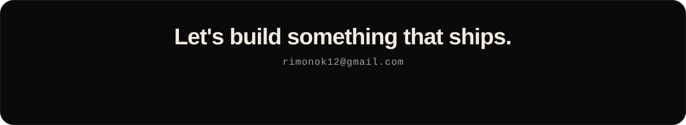

  
  
  

  
  
  

<h3 align="center"><code>~/whoami</code></h3>

<h3 align="center"><code>~/featured-work</code></h3>

Built and shipped solo. Click a card to open the live site.

  
  

  <b>Aegis</b> · <a href="https://aegis-portal-navy.vercel.app">Live</a> · <a href="https://github.com/Rimonok12/Vapt_Aegis">Code</a>
  &nbsp;&nbsp;|&nbsp;&nbsp;
  <b>Locus</b> · <a href="https://locus-navy.vercel.app">Live</a> · <a href="https://github.com/Rimonok12/Locus">Code</a>

  
  

  <b>FitnessPlus</b> · <a href="https://fitnessplus-redesign.vercel.app">Live</a> · <a href="https://github.com/Rimonok12/fitnessPlus">Code</a>
  &nbsp;&nbsp;|&nbsp;&nbsp;
  <b>Portfolio</b> · <a href="https://rimon-portfolio.vercel.app">Live</a> · <a href="https://github.com/Rimonok12/rimon-portfolio">Code</a>

  
<b>More projects</b>

   

| Project | What it is | Links |
|---|---|---|
| **ShortFlix** | Full-stack short-video mini platform, built as a take-home assignment | [Live](https://short-flix-three.vercel.app) · [Code](https://github.com/Rimonok12/SHORT-FLIX) |
| **Metagame Nexus** | Animated, award-style landing page for a gaming concept | [Live](https://rdn-awwardwinning.netlify.app/) · [Code](https://github.com/Rimonok12/awwardWinning) |
| **CVScoreAI** | ATS resume checker with keyword, structure and formatting feedback | [Code](https://github.com/Rimonok12/atsChecker) |
| **CartKoro** | E-commerce store for my own startup | [Code](https://github.com/Rimonok12/cartkoro-ecommerce) |
| **NeovaTech** | Company landing page | [Live](https://www.neovatech.in/) · [Code](https://github.com/Rimonok12/neovatechLanding) |

<h3 align="center"><code>~/experience</code></h3>

<h3 align="center"><code>~/stack</code></h3>

   
  

  <b>AI:</b> LLM integration (Claude, OpenAI, local Llama via Ollama) · prompt pipelines · data pipelines &nbsp;·&nbsp; <b>Motion:</b> GSAP · Motion · WebGL

<h3 align="center"><code>~/activity</code></h3>

  

<picture>
  <source media="(prefers-color-scheme: dark)" srcset="https://raw.githubusercontent.com/Rimonok12/RImonok12/output/github-snake-dark.svg" />
  <source media="(prefers-color-scheme: light)" srcset="https://raw.githubusercontent.com/Rimonok12/RImonok12/output/github-snake.svg" />
  
</picture>

  

